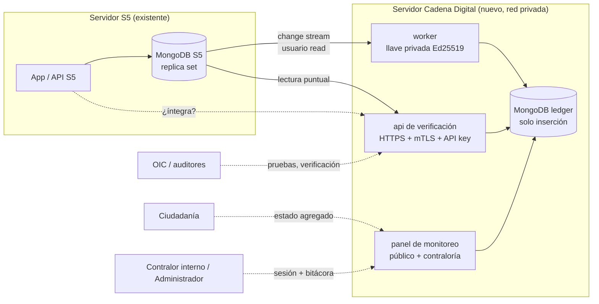

# Cadena Digital S5 — Sellado e integridad de denuncias de la PDN

Servicio en **Node.js** que incorpora una cadena digital (blockchain permisionada) al
**Sistema 5 (Denuncias)** de la Plataforma Digital Nacional. Registra la huella criptográfica
de cada alta, modificación y baja de una denuncia guardada en **MongoDB**, la agrupa en bloques
encadenados y firmados, y permite demostrar —incluso fuera de línea— que una denuncia
no ha sido alterada desde que se registró.

Se despliega en un **servidor separado** del S5: el S5 no conoce ni puede escribir en la cadena,
y la cadena solo lee el S5 con un usuario de solo lectura.

## Arquitectura



| Pieza | Qué hace |
|---|---|
| **Huella** | SHA-256 (u HMAC-SHA256 con *pepper*) sobre la serialización canónica Extended JSON del documento. Ningún dato personal sale del S5: la cadena solo guarda huellas. |
| **Entrada** | `{denunciaId, version, operacion (alta/modificacion/baja), hashDocumento, observadoEn, origen}` |
| **Bloque** | Entradas + raíz de Merkle + `prevHash` + firma Ed25519. Índice único → no hay bifurcaciones. |
| **Conciliación** | Cada 6 h recalcula todas las huellas del S5. Un cambio no visto por el change stream (p. ej. edición directa en MongoDB con el servicio detenido) queda registrado con `origen: conciliacion` y genera una **ALERTA** en bitácora. |

### Qué detecta

- Modificación o borrado de una denuncia en el S5 (por la app o directo en la base): queda el historial de versiones, y la versión original no puede borrarse de la cadena.
- Alteración de la propia cadena: editar una entrada rompe su `entryId`, la raíz de Merkle, el hash, la firma y el enlace con el bloque siguiente. Borrar un bloque rompe la secuencia.
- Bloques falsificados con otra llave: la firma no corresponde a ninguna llave de confianza.

## Estructura

```
src/
  core/        canonical.js · hash.js · merkle.js · block.js · signer.js
  ledger/      store.js · ledger.js (génesis, sellado, verificación, pruebas) · alerts.js · integridad.js
  sync/        source.js (S5 solo lectura) · recorder.js · worker.js (change stream + conciliación)
  api/         app.js (rutas) · security.js (API key, lista de IPs)
  panel/       app.js (dashboard: público / contralor / administrador) · auth.js · public/ (interfaz)
  index.js     arranque por ROL (worker | api | panel | todo) o --rol=
scripts/       generar-llaves · generar-llave-api · verificar-cadena · verificar-prueba · usuario-panel · demo-panel
mongo/         crear-usuario-s5.js · crear-roles-ledger.js
test/          26 pruebas (node:test), incluidas las de privacidad y control de acceso del panel
```

## Instalación

Requisitos: Node.js ≥ 22.9, MongoDB del S5 como **replica set** (para change streams; si no lo es, use `S5_MODO=sondeo`) y un MongoDB propio para el ledger.

```bash
npm ci
npm test

# 1. Llaves de firma (la privada solo en el worker; respaldar en bóveda/HSM)
npm run llaves

# 2. (Recomendado) pepper para HMAC de huellas
openssl rand -base64 48 > llaves/pepper.txt && chmod 600 llaves/pepper.txt

# 3. Usuarios de MongoDB
mongosh "mongodb://admin@servidor-s5:27017/admin"  mongo/crear-usuario-s5.js     # en el S5
mongosh "mongodb://admin@ledger-db:27017/admin"    mongo/crear-roles-ledger.js   # en el ledger

# 4. Llaves de API para consumidores (en .env se guarda solo el SHA-256)
npm run llave-api

# 5. Configuración y arranque
cp .env.example .env && chmod 600 .env
npm run start:worker     # servidor/proceso que sella
npm run start:api        # servidor/proceso que responde consultas
# o con contenedores:
docker compose up -d
```

## API (`/api/v1`, encabezado `X-API-Key`)

| Método | Ruta | Respuesta |
|---|---|---|
| GET | `/cadena/cabeza` | Último bloque (encabezado, hash, firma) y entradas pendientes |
| GET | `/cadena/bloques/:index` | Bloque completo |
| GET | `/cadena/verificacion` | Verificación total de la cadena (200 íntegra · 409 alterada) |
| GET | `/denuncias/:id/historial` | Versiones selladas y pendientes |
| GET | `/denuncias/:id/prueba[?entrada=<entryId>]` | Prueba de inclusión Merkle verificable fuera de línea |
| GET | `/denuncias/:id/integridad` | ¿El documento vigente en el S5 coincide con la última huella sellada? |
| POST | `/documentos/verificar` | `{ "documento": {…Extended JSON…} }` → ¿esa versión exacta fue sellada? |
| GET | `/salud` | Sin autenticación, para el balanceador |

Ejemplo de integración desde el backend del S5 (al mostrar una denuncia o generar un acuse):

```js
const r = await fetch(`https://cadena.interno:8443/api/v1/denuncias/${id}/integridad`, {
  headers: { 'X-API-Key': process.env.CADENA_API_KEY },
});
const { integra, mensaje } = await r.json(); // integra === false → alerta al OIC
```

### Verificación independiente

```bash
# Toda la cadena (cron diario o auditor con usuario s5_cadena_audit)
LEDGER_MONGO_URI=... LLAVES_CONFIANZA_DIR=./llaves/confianza npm run verificar-cadena   # exit 0 / 2

# Una denuncia, sin acceso a bases de datos
npm run verificar-prueba -- prueba.json llaves/confianza/<keyId>.pem documento.json
```

## Instalación en un solo equipo Windows (MongoDB + sellado + panel)

Para un equipo que alojará todo (por ejemplo, el piloto en `192.168.1.77`). En PowerShell **como administrador**, desde la carpeta del proyecto:

```powershell
powershell -ExecutionPolicy Bypass -File .\scripts\windows\instalar-cadena.ps1
```

El script (se puede repetir sin perder nada):

1. Descarga MongoDB Community 8.0 y mongosh dentro de `MongoDB\` (verifica la huella SHA-256 del ZIP).
   Sin internet: `-MongoZip <zip> -MongoshZip <zip>`.
2. Configura MongoDB en el puerto **2730**, escuchando **solo en 127.0.0.1**, como *replica set* `rs0` con autenticación y *keyfile*, y lo registra como servicio de Windows `MongoDBCadenaS5` (inicio automático).
3. Crea el administrador de MongoDB, la base `s5_cadena`, los roles de mínimo privilegio y cinco usuarios de servicio con contraseñas aleatorias, guardadas en `MongoDB\credenciales\` con permisos restringidos.
4. Genera la llave de firma, el *pepper*, el secreto de sesiones y un **certificado HTTPS temporal autofirmado** (`tls\panel.pfx`, 12 meses) para la IP indicada.
5. Actualiza `.env` (con respaldo previo), crea `.env.worker` y `.env.api` con el usuario de MongoDB de cada servicio, abre el puerto 8444 en el firewall (redes privadas y de dominio) y hace una prueba de arranque del panel.

Parámetros: `-IpPanel` (192.168.1.77), `-PuertoPanel` (8444), `-PuertoMongo` (2730), `-MesesCertificado` (12).

Después:

```powershell
npm run usuario-panel -- alta admin.ti administrador "Nombre Apellido"
powershell -ExecutionPolicy Bypass -File .\scripts\windows\iniciar-cadena.ps1
```

`iniciar-cadena.ps1` arranca MongoDB si hace falta, el panel y, cuando `.env` ya tiene `S5_MONGO_URI`, el servicio de sellado. Para que el navegador no advierta del certificado temporal, instale `tls\panel.cer` en los equipos cliente como *Entidad de certificación raíz de confianza*; en producción sustitúyalo por un certificado institucional (`PANEL_TLS_PFX_PATH` o `PANEL_TLS_CERT_PATH`/`PANEL_TLS_KEY_PATH`).


## Panel de monitoreo de integridad (`ROL=panel`)

Dashboard web de **uso público** para vigilar la integridad de la cadena y dar seguimiento a las
anomalías. Se ejecuta como un proceso propio (puerto 8444), sin llave privada y, por defecto,
**sin acceso al S5**.

```bash
npm run demo-panel        # demostración con datos simulados, sin MongoDB → http://127.0.0.1:8444
npm run start:panel       # producción (lee el ledger con el usuario s5_cadena_panel)
```

### Niveles de acceso

| Nivel | Cómo accede | Qué ve |
|---|---|---|
| **Público** | Sin sesión | Estado global (íntegra · en observación · comprometida), bloques sellados, registros verificados, actividad de 30 días, encabezados de bloque y anomalías **anonimizadas**. |
| **Contralor interno** | Usuario y contraseña | Todo lo anterior + detalle completo de cada anomalía (número de denuncia, huellas, evidencia técnica), historial de versiones, comparación en vivo con el S5, consulta por denuncia y **registro de seguimiento**. |
| **Administrador** | Usuario y contraseña | Todo lo del Contralor + **bitácora de accesos**, estado operativo del servicio y verificación manual de la cadena. |

### Protección de datos personales en la vista pública

- No se publican números de denuncia, huellas de documentos, notas de investigación ni nombres de usuarios.
- El **folio** de cada anomalía (`AL-XXXX-XXXX-XXXX-XXXX`) es aleatorio: no se deriva del número de la denuncia, por lo que no permite confirmar si una denuncia concreta fue alterada.
- Las fechas públicas se reducen al **día** (sin hora) para dificultar correlaciones con hechos externos.
- Los conteos diarios y por bloque de altas, modificaciones y bajas **menores a 5 se suprimen** (se muestran como «<5»).
- La API pública responde solo con datos agregados; la interfaz usa `textContent` y una CSP estricta (`script-src 'self'`, sin recursos externos).

### Controles del acceso restringido

- Contraseñas con **scrypt** (N=2^15); comparación en tiempo constante, incluso para usuarios inexistentes.
- Sesión en cookie `HttpOnly` + `SameSite=Strict` (+ `Secure` con TLS), firmada con HMAC; expira por **inactividad (30 min)** y por **duración máxima (8 h)**.
- En cada petición se vuelve a validar la cuenta: desactivarla, cambiarle el rol o la contraseña **cierra sus sesiones de inmediato**.
- Bloqueo por cuenta (5 intentos fallidos / 15 min) y por IP (10 fallos / 15 min); defensa CSRF con encabezado propio.
- Opcional: `PANEL_IPS_PRIVILEGIADAS` limita el inicio de sesión a la red institucional.
- **Bitácora de accesos** (solo inserción): inicios y cierres de sesión, accesos denegados y cada consulta de información reservada (qué alerta o denuncia, quién, desde qué IP y cuándo).
- El **seguimiento** de anomalías es solo inserción: cada cambio de estado exige una nota y queda firmado con el usuario.

### Cuentas

Las cuentas se administran por línea de comandos con el usuario de base `s5_cadena_gestor`; el panel solo puede leerlas.

```bash
npm run usuario-panel -- alta jperez contralor "Juana Pérez"
npm run usuario-panel -- alta admin.ti administrador "Administración de TI"
npm run usuario-panel -- contrasena jperez      # cambia contraseña y cierra sesiones
npm run usuario-panel -- baja jperez            # desactiva (no se borra: preserva la bitácora)
npm run usuario-panel -- lista
```

### Anomalías que se registran

| Tipo | Severidad | Origen |
|---|---|---|
| Inconsistencia en la cadena | Crítica | Verificación integral (worker cada hora, API o verificación manual) |
| Colección del S5 eliminada o invalidada | Crítica | Change stream |
| Cambio no reportado por el flujo de eventos | Alta | Conciliación periódica |
| Documento vigente distinto al sellado | Alta | Consulta de integridad (API o panel) |
| Hueco en el flujo de cambios | Media | Pérdida del punto de reanudación del oplog |

Cada anomalía se guarda **una sola vez** (deduplicación por huella de su contenido) en la colección `alertas`, que es de solo inserción.

### Endpoints del panel

| Ruta | Nivel |
|---|---|
| `GET /api/publico/resumen` · `actividad` · `bloques?antesDe=` · `alertas?pagina=` · `alertas/:folio` · `catalogo` | Público |
| `POST/GET/DELETE /api/sesion` | — |
| `GET /api/privado/alertas` · `alertas/:id` · `denuncias/:id` · `POST alertas/:id/seguimiento` | Contralor y Administrador |
| `GET /api/admin/bitacora` · `operacion` · `POST verificar` | Administrador |


## Seguridad del servidor separado

- **Red**: el MongoDB del ledger no publica puertos (red Docker `internal`). Firewall: solo el worker sale hacia el puerto 27017 del S5; solo IPs autorizadas entran al 8443.
- **Mínimo privilegio**: el S5 se lee con rol `read`. El worker puede *insertar* bloques pero no *modificarlos* ni *borrarlos* (`cadenaEscritor`). La API usa un usuario de solo lectura y **no tiene la llave privada**: si la API se compromete, no se pueden firmar bloques.
- **API**: HTTPS obligatorio (TLS ≥ 1.2), mTLS opcional (`TLS_CA_PATH`), llaves de API comparadas en tiempo constante y guardadas solo como SHA-256, lista blanca de IPs, límite de peticiones, `helmet`, cuerpo ≤ 1 MB, errores sin *stack*.
- **Contenedores**: usuario sin privilegios, sistema de archivos de solo lectura, `cap_drop: ALL`, `no-new-privileges`, llave privada como *secret*.
- **Privacidad**: la cadena no contiene datos de denunciantes; con *pepper* las huellas tampoco pueden confirmarse por fuerza bruta.
- **Bitácora**: JSON por línea; enviar al SIEM y alertar sobre los mensajes que inician con `ALERTA`.

### Anclaje externo (recomendado)

Quien controle a la vez la llave privada y la base del ledger podría, en teoría, reescribir la cadena completa. Para cerrarlo, publique periódicamente el hash de la cabeza (`GET /cadena/cabeza`) fuera del control del operador: sitio público de la SESNA, correo firmado al OIC, Diario Oficial, o una cadena pública (p. ej. sellado OpenTimestamps sobre Bitcoin). Cualquier reescritura posterior dejará de coincidir con esos puntos de control.

## Alcance y limitaciones

- Es una **cadena permisionada de un solo operador**: hace las alteraciones *evidentes* y demostrables, no imposibles. Para consenso entre varias instituciones (p. ej. SESNA + sistemas estatales) el mismo modelo de entradas puede migrarse a Hyperledger Fabric o a nodos replicados que verifiquen y co-firmen cada bloque.
- Con `S5_FULL_DOCUMENT=updateLookup` se registra el estado del documento al momento de leer el evento; si hay dos cambios casi simultáneos, el intermedio puede no quedar sellado (el final sí). En MongoDB 6+ habilite `changeStreamPreAndPostImages` y use `required` para registrar cada versión exacta.
- Los valores numéricos se hashean como los entrega el controlador de Node (un `double 5.0` y un `int 5` dan la misma huella).
- `S5_COLLECTION` y `S5_ID_TYPE` deben ajustarse al esquema real de su instalación del S5; los campos técnicos volátiles se excluyen con `S5_EXCLUDE_FIELDS`.
- Las pruebas automatizadas usan un almacén en memoria; antes de producción ejecute una prueba de integración contra réplicas de MongoDB del S5 y del ledger.
